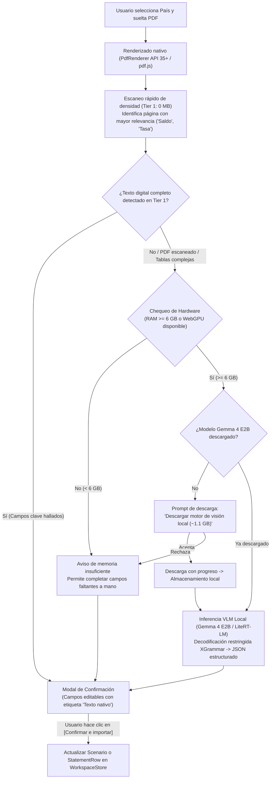

# Especificación: Pipeline Híbrido de Ingesta y Análisis de Extractos Bancarios (PDF en Edge)

**Estado:** Aprobado tras entrevista `/grill-me` (2026-10-12)  
**Alcance:** Ingesta y extracción local de condiciones de préstamos y filas de extractos bancarios en Android y Web (Kotlin Multiplatform), sin depender de plantillas fijas de bancos ni servicios en la nube (100% privado en edge).

---

## 1. Resumen Ejecutivo y Objetivos

El módulo de ingesta de documentos permite a los usuarios de **finsim** cargar extractos bancarios en formato PDF para:
1. **Inicializar un Nuevo Escenario:** Extraer capital inicial o saldo actual, plazo, tasa de interés (EA/EM/Nominal) y seguros para crear o reconfigurar un préstamo sin digitación manual.
2. **Auditar un Mes en Conciliación:** Extraer los cobros efectivos de un mes (capital pagado, intereses cobrados, seguros facturados, saldo final) para contrastarlos automáticamente contra la cuota teórica simulada.

### Principios de Diseño
* **Cero plantillas fijas:** No se mantienen expresiones regulares ni coordenadas fijas por banco. El motor debe ser inmune al rediseño visual de los extractos.
* **100% Privado en Edge (Sin BYOK ni nube):** El procesamiento ocurre estrictamente en el dispositivo del usuario. Ningún byte o dato bancario sale de la máquina.
* **Preservación del tamaño base (~25 MB):** La app base no incluye pesos de modelos pesados. Los pesos de IA visual son un módulo opcional descargable bajo demanda.
* **Humano en el bucle (Human-in-the-loop):** Todo dato extraído debe pasar por un modal de confirmación con campos editables antes de mutar el estado financiero ([`WorkspaceStore`](file:///C:/Users/Lenovo/Documents/finsim/kmp/shared/src/commonMain/kotlin/com/finsim/workspace/WorkspaceStore.kt)).

---

## 2. Decisiones Arquitectónicas Acordadas (`/grill-me`)

| Dimensión | Decisión Acordada | Razón / Impacto |
| :--- | :--- | :--- |
| **Propósito de entrada** | **Doble propósito:** Crear nuevo escenario u operar sobre pestaña de conciliación. | Maximiza la utilidad tanto en onboarding inicial como en auditoría mensual recurrente. |
| **Marco regulatorio / País** | **Selector explícito previo en modal de carga.** | Evita adivinanzas heurísticas. Fija moneda por defecto, orden de imputación y reglas de prepago (ej. Ley 546 en Colombia) antes del análisis. |
| **Transición de niveles (Triage)** | **Cascada automática con confirmación:** Tier 1 (texto digital, 0 MB) primero; si faltan campos o es escaneado, ofrecer Tier 2 (VLM, ~1.1 GB). | Evita descargas innecesarias de 1.1 GB para documentos digitales simples. |
| **Control de hardware (RAM)** | **Puerta estricta por hardware (<6 GB RAM bloquea Tier 2).** | Previene que el Android LMKD cierre forzosamente la aplicación por falta de memoria. Permite completar manualmente. |
| **Múltiples páginas** | **Escaneo rápido de densidad en Tier 1 + análisis de página ganadora.** | Identifica la página con mayor densidad de términos clave ('Saldo', 'Tasa', 'Seguros') y solo envía esa página al VLM (ahorra batería y calor). |
| **Revisión de resultados** | **Modal / Bottom Sheet interactivo con campos editables.** | Ningún dato sobreescribe el modelo en silencio. El usuario verifica y ajusta los valores antes de confirmar. |
| **Almacenamiento del modelo** | **Persistente en disco con botón explícito de 'Liberar espacio'.** | Permite reusar el modelo offline sin volver a descargarlo, pero otorga control total para recuperar los ~1.1 GB cuando el usuario quiera. |

---

## 3. Arquitectura del Pipeline en Cascada



---

## 4. Contratos y Esquema de Extracción (Domain Contracts)

### 4.1 Esquema de Salida JSON Restringido
La inferencia de Tier 2 se ejecuta bajo una gramática JSON rígida (XGrammar / GBNF) que mapea directamente a los modelos de dominio de finsim:

```kotlin
package com.finsim.ingestion

import com.finsim.domain.Currency
import com.finsim.domain.Rate

/**
 * Resultado estructurado emitido por el pipeline de extracción.
 */
data class ExtractedDocumentData(
    val sourceEngine: ExtractionEngine,       // TIER_1_DIGITAL_TEXT o TIER_2_LOCAL_VLM
    val analyzedPage: Int,
    val bankNameCandidate: String?,
    val statementMonth: Int?,
    val closingBalance: String?,              // Cadena con formato Decimal
    val originalPrincipal: String?,
    val termMonths: Int?,
    val rate: ExtractedRate?,
    val monthlyPayment: String?,
    val insurances: List<ExtractedInsurance>,
    val confidence: Float                     // 0.0f a 1.0f
)

enum class ExtractionEngine {
    TIER_1_DIGITAL_TEXT,
    TIER_2_LOCAL_VLM
}

data class ExtractedRate(
    val valuePercent: String,                 // "18.5"
    val kind: String,                         // "annual", "monthly", "nominal"
    val nominalFrequency: Int?
)

data class ExtractedInsurance(
    val name: String,                         // "Seguro de vida", "Seguro deudores"
    val monthlyCost: String                   // "12450.00"
)
```

---

## 5. Módulos y Límites de Responsabilidad (KMP)

```
kmp/
├── shared/src/commonMain/kotlin/com/finsim/
│   ├── ingestion/
│   │   ├── DocumentIngestionPipeline.kt      // Orquestador en cascada (interfaz expect/actual)
│   │   ├── ExtractedDocumentData.kt          // Contratos de datos inmutables
│   │   ├── PageDensityScanner.kt             // Escaneo de palabras clave en texto plano
│   │   └── DeviceCapabilityGate.kt           // Interfaz de consulta de RAM / WebGPU
│   └── domain/
│       └── ...                               // Scenario, Rate, Currency, Decimal
│
├── composeApp/src/commonMain/kotlin/com/finsim/app/
│   ├── ui/ingestion/
│   │   ├── DocumentImportDialog.kt           // Modal previo: País, selector de archivo y estado
│   │   ├── ModelDownloadProgressCard.kt      // UI de progreso de descarga (~1.1 GB) y botón 'Liberar espacio'
│   │   └── ExtractionReviewSheet.kt          // Bottom sheet de confirmación con campos editables
│   └── App.kt                                // Puntos de entrada en Toolbar y Reconciliation
│
├── composeApp/src/androidMain/kotlin/com/finsim/app/ingestion/
│   ├── AndroidPdfRasterizer.kt               // PdfRenderer (API 35+) escalado a 150 DPI
│   ├── AndroidDeviceCapability.kt            // ActivityManager.MemoryInfo (RAM disponible y total)
│   └── LiteRtVlmRunner.kt                    // LiteRT-LM con Gemma 4 E2B INT4 y NPU QNN
│
└── composeApp/src/wasmJsMain/kotlin/com/finsim/app/ingestion/
    ├── WasmPdfRasterizer.kt                  // Renderizado vía canvas / pdf.js
    ├── WasmDeviceCapability.kt               // Verificación de navigator.gpu y navigator.deviceMemory
    └── WebLlmVlmRunner.kt                    // WebLLM / ONNX Runtime WebGPU
```

---

## 6. Fases de Implementación

1. **Fase 1: Contratos, Diálogo de Carga y Tier 1 (0 MB)**
   - Creación de contratos [`ExtractedDocumentData`](file:///C:/Users/Lenovo/Documents/finsim/kmp/shared/src/commonMain/kotlin/com/finsim/ingestion/ExtractedDocumentData.kt).
   - Diálogo de carga con selector de país/marco regulatorio ([`DocumentImportDialog`](file:///C:/Users/Lenovo/Documents/finsim/kmp/composeApp/src/commonMain/kotlin/com/finsim/app/ui/ingestion/DocumentImportDialog.kt)).
   - Rasterizador nativo de páginas a 150 DPI en Android (`PdfRenderer`) y Web.
   - Escáner rápido de texto digital y palabras clave (Tier 1).
   - Modal de revisión final con campos editables antes de aplicar a [`WorkspaceStore`](file:///C:/Users/Lenovo/Documents/finsim/kmp/shared/src/commonMain/kotlin/com/finsim/workspace/WorkspaceStore.kt).

2. **Fase 2: Puerta de Hardware y Gestor de Descarga de Modelo**
   - Implementación de [`DeviceCapabilityGate`](file:///C:/Users/Lenovo/Documents/finsim/kmp/shared/src/commonMain/kotlin/com/finsim/ingestion/DeviceCapabilityGate.kt) (bloqueo estricto si RAM < 6 GB).
   - Gestor de descarga bajo demanda para el modelo Gemma 4 E2B INT4 (~1.1 GB) con barra de progreso.
   - Opción explícita de *"Eliminar modelo de IA local / Liberar 1.1 GB"* en ajustes/barra de herramientas.

3. **Fase 3: Motor de Inferencia VLM Local (Tier 2)**
   - Integración de LiteRT-LM en Android con delegación a NPU/GPU.
   - Decodificación restringida XGrammar / JSON Schema para extracción garantizada sin alucinaciones de formato.
   - Pruebas con extractos reales (digitales y escaneados) y verificación de temperatura/batería.
