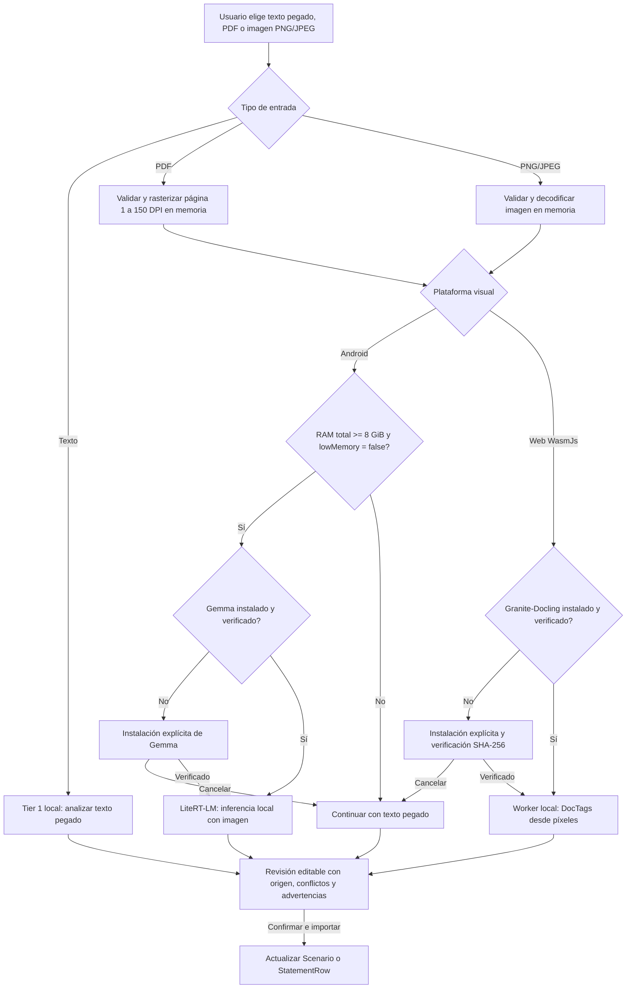

# Especificación: Pipeline Híbrido de Ingesta y Análisis de Extractos Bancarios (PDF en Edge)

**Estado:** Aprobado tras entrevista `/grill-me` (2026-10-12)  
**Alcance:** Ingesta y extracción local de condiciones de préstamos y filas de extractos bancarios en Android y Web (Kotlin Multiplatform), sin depender de plantillas fijas de bancos ni servicios de inferencia en la nube. Android conserva Gemma; la Web usa Granite-Docling en un Worker WasmJs. PDF, PNG y JPEG son entradas visuales distintas del texto pegado, y toda salida sigue pasando por revisión humana.

---

## 1. Resumen Ejecutivo y Objetivos

El módulo de ingesta de documentos permite a los usuarios de **finsim** cargar extractos bancarios en formato PDF para:
1. **Inicializar un Nuevo Escenario:** Extraer capital inicial o saldo actual, plazo, tasa de interés (EA/EM/Nominal) y seguros para crear o reconfigurar un préstamo sin digitación manual.
2. **Auditar un Mes en Conciliación:** Extraer los cobros efectivos de un mes (capital pagado, intereses cobrados, seguros facturados, saldo final) para contrastarlos automáticamente contra la cuota teórica simulada.

### Principios de Diseño
* **Cero plantillas fijas:** No se mantienen expresiones regulares ni coordenadas fijas por banco. El motor debe ser inmune al rediseño visual de los extractos.
* **100% Privado en Edge (Sin BYOK ni nube):** El procesamiento ocurre estrictamente en el dispositivo del usuario. Ningún byte o dato bancario sale de la máquina.
* **Preservación del tamaño base (~25 MB):** La app base no incluye pesos de modelos pesados. Los pesos de IA visual son un módulo opcional descargable bajo demanda.
* **Humano en el bucle (Human-in-the-loop):** Todo dato extraído debe pasar por un modal de confirmación con campos editables antes de mutar el estado financiero ([`WorkspaceStore`](file:///C:/Users/Lenovo/Documents/finsim/kmp/shared/src/commonMain/kotlin/com/finsim/workspace/WorkspaceStore.kt)).

---

## 2. Decisiones Arquitectónicas Acordadas (`/grill-me`)

| Dimensión | Decisión Acordada | Razón / Impacto |
| :--- | :--- | :--- |
| **Propósito de entrada** | **Doble propósito:** Crear nuevo escenario u operar sobre pestaña de conciliación. | Maximiza la utilidad tanto en onboarding inicial como en auditoría mensual recurrente. |
| **Marco regulatorio / País** | **Selector explícito previo en modal de carga.** | Evita adivinanzas heurísticas. Fija moneda por defecto, orden de imputación y reglas de prepago (ej. Ley 546 en Colombia) antes del análisis. |
| **Entradas y niveles** | El texto pegado se procesa con Tier 1. PDF, PNG y JPEG son entradas visuales; Android usa Gemma y Web Granite-Docling tras una instalación explícita de su modelo local. | Evita tratar bytes PDF como texto y evita descargar modelos para texto manual suficiente. |
| **Control de recursos** | Android habilita Gemma con al menos 8 GiB de RAM total y sin presión actual (`ActivityManager.MemoryInfo.lowMemory`). Web limita archivos a 25 MiB y 12 MP y ofrece análisis local tras instalar Granite-Docling. | Separa los límites propios de cada runtime y conserva un camino manual cuando no se cumplen. |
| **Páginas** | El texto pegado puede segmentarse y Tier 1 elige su página con mayor densidad. El análisis PDF procesa explícitamente la página 1 a 150 DPI; una imagen se analiza directamente. | La UI indica la página analizada y no afirma extracción del documento completo. |
| **Revisión de resultados** | **Modal / Bottom Sheet interactivo con campos editables.** | Ningún dato sobreescribe el modelo en silencio. El usuario verifica y ajusta los valores antes de confirmar. |
| **Modelo visual por plataforma** | Android usa Gemma mediante LiteRT-LM; Web usa Granite-Docling ONNX en un Web Worker local. Ambos alimentan los contratos comunes de `:shared` y la misma revisión editable. | El runtime se adapta a cada plataforma sin duplicar las reglas financieras ni enviar documentos a un servicio remoto. |
| **Almacenamiento del modelo** | Cada modelo es opcional, se instala con una acción explícita y se valida antes de inferir. Android conserva sus pesos en almacenamiento privado; Web guarda artefactos de una revisión Granite-Docling fijada y valida cada tamaño/SHA-256 en Cache Storage. | Permite inferencia sin conexión después de la instalación y hace visibles el costo local y la acción de liberar almacenamiento. |

---

## 3. Arquitectura del Pipeline en Cascada



---

## 4. Contratos y Esquema de Extracción (Domain Contracts)

### 4.1 Contrato común de salida revisable
Ambos motores producen `ExtractedDocumentData` y el usuario revisa los candidatos antes de aplicar cambios. Gemma conserva su salida JSON restringida. Granite-Docling produce DocTags OTSL, que se interpretan con un adaptador semántico; no se atribuye a Docling una gramática JSON que el modelo no genera.

```kotlin
package com.finsim.ingestion

import com.finsim.domain.Currency
import com.finsim.domain.Rate

/**
 * Contrato común al que se adaptan la salida JSON de Gemma y los DocTags de Granite-Docling.
 */
data class ExtractedDocumentData(
    val sourceEngine: ExtractionEngine,       // Texto, Gemma o Granite-Docling
    val analyzedPage: Int,
    val bankNameCandidate: String?,
    val statementMonth: Int?,
    val closingBalance: String?,              // Cadena con formato Decimal
    val originalPrincipal: String?,
    val termMonths: Int?,
    val rate: ExtractedRate?,
    val monthlyPayment: String?,              // No se usa como cuota base si el significado es ambiguo
    val basePayment: String?,
    val totalPayment: String?,                 // Puede incluir seguros; nunca se mezcla con basePayment
    val paymentMeaning: PaymentMeaning,
    val insurances: List<ExtractedInsurance>,
    val confidence: Float                     // 0.0f a 1.0f
)

enum class ExtractionEngine {
    TIER_1_DIGITAL_TEXT,
    TIER_2_LOCAL_VLM,
    TIER_2_LOCAL_DOCLING
}

enum class PaymentMeaning {
    BASE_PAYMENT,
    TOTAL_PAYMENT,
    UNKNOWN
}

data class ExtractedRate(
    val valuePercent: String,                 // "18.5"
    val kind: String,                         // "annual", "monthly", "nominal"
    val nominalFrequency: Int?
)

data class ExtractedInsurance(
    val name: String,                         // "Seguro de vida", "Seguro deudores"
    val monthlyCost: String                   // "12450.00"
)
```

---

## 5. Módulos y Límites de Responsabilidad (KMP)

```
kmp/
├── shared/src/commonMain/kotlin/com/finsim/ingestion/
│   ├── HybridDocumentOrchestrator.kt         // Texto pegado, gate, página e invocación Tier 2
│   ├── DocumentIngestionRuntime.kt           // Dependencias por plataforma
│   ├── PageRasterizer.kt                     // Contrato y límites de memoria
│   ├── ExtractedDocumentData.kt              // Contratos revisables
│   ├── VlmJsonGrammar.kt                     // Salida JSON restringida de Gemma
│   └── DoclingDocTagsParser.kt               // DocTags/OTSL a candidatos semánticos
├── shared/src/androidMain/kotlin/com/finsim/ingestion/
│   ├── PageRasterizer.android.kt             // PdfRenderer sobre descriptor de bytes en memoria
│   ├── AndroidModelDownloader.kt              // Descarga fijada y streaming
│   ├── AndroidModelStorage.kt                 // Archivo privado persistente y SHA-256
│   └── AndroidGemmaVisionRunner.kt             // LiteRT-LM 0.18 con imagen real y backend CPU
├── shared/src/wasmJsMain/kotlin/com/finsim/ingestion/
│   └── DoclingWebRuntime.wasmJs.kt             // Cache, Worker, rasterización PDF y análisis local
└── composeApp/
    ├── docling-worker/src/worker.mjs           // Transformers.js, PDF.js y ONNX Runtime local
    └── src/{commonMain,androidMain,wasmJsMain}/.../ingestion/
        ├── DocumentImportDialog.kt             // Texto pegado y archivos visuales separados
        └── PdfDocumentPicker.*                 // Selección Android/Web
```

---

## 6. Fases de Implementación

1. **Fase 1: Contratos, Diálogo de Carga y Tier 1 (0 MB)**
   - Creación de contratos [`ExtractedDocumentData`](file:///C:/Users/Lenovo/Documents/finsim/kmp/shared/src/commonMain/kotlin/com/finsim/ingestion/ExtractedDocumentData.kt).
   - Diálogo de carga con selector de país/marco regulatorio ([`DocumentImportDialog`](file:///C:/Users/Lenovo/Documents/finsim/kmp/composeApp/src/commonMain/kotlin/com/finsim/app/ui/ingestion/DocumentImportDialog.kt)).
   - Tier 1 para texto pegado y selección de su página más relevante.
   - Selector SAF Android y selección Web para PDF, PNG y JPEG. El PDF se rasteriza a 150 DPI en memoria; la imagen se entrega directamente al runtime visual local.
   - Modal de revisión final con campos editables antes de aplicar a [`WorkspaceStore`](file:///C:/Users/Lenovo/Documents/finsim/kmp/shared/src/commonMain/kotlin/com/finsim/workspace/WorkspaceStore.kt).

2. **Fase 2: Puerta de Hardware y Gestor de Descarga de Modelo**
   - Gate Android de RAM total >= 8 GiB y presión de memoria actual separada.
   - Descarga streaming bajo demanda de Gemma 4 E2B fijado (2.583.085.056 bytes) con validación de nombre, tamaño y SHA-256.
   - Opción explícita para eliminar el modelo local y liberar hasta 2,58 GB.

3. **Fase 3: Motor de Inferencia VLM Local (Tier 2)**
   - Integración real de LiteRT-LM en Android con entrada de imagen, backend CPU, sampler determinista y speculative decoding deshabilitado.
   - Decodificación restringida JSON para evitar formatos de salida ambiguos; los valores ausentes se conservan como ausentes.
   - Pruebas con extractos reales (digitales y escaneados) y verificación de temperatura/batería.

4. **Fase 4: Granite-Docling local en Web (Issue #33)**
   - Worker WasmJs con revisión de modelo fijada, manifiesto completo con tamaño/SHA-256, instalación explícita y bloqueo de descargas de inferencia no verificadas.
   - PDF página 1 a 150 DPI e imágenes PNG/JPEG en memoria; salida DocTags OTSL al contrato común, con advertencias semánticas y revisión previa.
   - La inferencia de navegador debe verificarse con un resultado real y revisar sus campos antes de cerrar la fase; una compilación exitosa o una sonda sin salida no demuestra aceptación.
